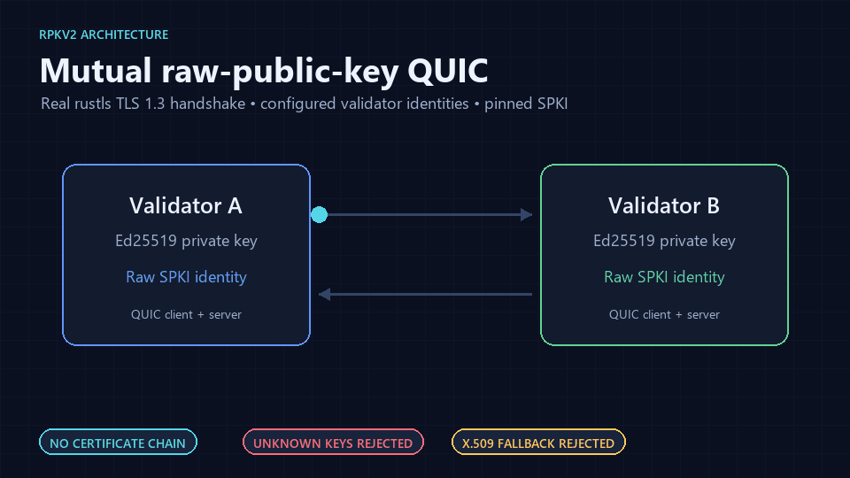

<div align="center">

# rpkv2

*Low-latency validator networking and processing over mutually authenticated
raw-public-key QUIC/TLS 1.3.*

[Overview](#what-is-implemented) ·
[Architecture](#architecture) ·
[Quick start](#quick-start) ·
[Security](docs/tls-rpk-security-review.md) ·
[Benchmarks](docs/benchmark-plan.md) ·
[Roadmap](docs/roadmap.md)

[](https://github.com/johnaco96/rpkv2/actions/workflows/ci.yml)
[](Cargo.toml)
[](LICENSE)
[](#architecture)
[](docs/tls-rpk-security-review.md)
[](https://www.rfc-editor.org/rfc/rfc7250)
[](#current-limits)

</div>



`rpkv2` is a Rust research prototype for authenticated blockchain-validator
networking and execution. It combines mutually authenticated QUIC/TLS 1.3
connections using RFC 7250-style raw public keys with a bounded, tile-style
transaction pipeline.

The project is intentionally not presented as a production validator or as
compatible with Solana/Firedancer. Its purpose is to explore the engineering
tradeoffs in validator identity, replay protection, backpressure, deterministic
execution, ledger recovery, fork choice, propagation, and performance
measurement.

## What is implemented

- Mutual raw-public-key authentication with Quinn and rustls. Both peers are
  mapped to configured validator identities by pinned DER-encoded
  SubjectPublicKeyInfo (SPKI).
- A versioned 118-byte validator packet header with canonical signature
  preimages, cluster separation, payload hashing, and bounded per-validator
  replay state.
- Bounded queues and explicit overload policies across independent processing
  stages.
- Batched Ed25519 verification, transaction packing, deterministic execution,
  slot batching, chained PoH-style entry hashing, shredding, signing, and
  storage experiments.
- A validator set, weighted leader schedule, signed consensus messages,
  equivocation evidence, fork tree, fork choice, finality rules, and replay.
- Integrity-checked blockstore records, snapshots, recovery policies, metrics,
  health checks, structured logging, and supervised shutdown.
- QUIC integration, conformance, recovery, malformed-input, and documentation
  contract tests. The default test suite contains more than 200 tests.
- CSV/JSON benchmark and soak-test tooling with queue, drop, latency, CPU, RSS,
  and storage accounting.

## Architecture

The network-facing pipeline keeps resource limits and ownership boundaries
explicit:

```text
mutual-RPK QUIC ingress
          |
          v
 peer limits -> dedupe -> verify -> ordered pack -> bank
                                                   |
                                                   v
                    chained entry hash -> shred -> sign -> storage
```

Signed block/shred propagation, repair, and peer fanout are implemented as
separate protocol experiments. They are not yet wired into the configured
runtime above.

The supporting validator model is split into focused modules:

```text
validator set -> leader schedule -> signed proposals/votes
                                      |
                                      v
blockstore <-> fork tree -> fork choice -> replay -> state database
                                      |
                                      v
                               snapshots/recovery
```

This is a safe-Rust implementation; the crate contains no `unsafe` blocks.

## Why raw public keys?

RFC 7250 allows TLS peers to authenticate with a raw public key instead of an
X.509 certificate chain. In this project, the authenticated object is an
Ed25519 SubjectPublicKeyInfo value: it contains a 32-byte Ed25519 public key
plus its DER algorithm and structure metadata.

That removes certificate-authority and chain-validation semantics from the
validator trust model, but it does not remove key-management work. Identity
binding, distribution, rotation, and revocation become explicit operator
responsibilities. The implementation therefore uses configured validator
registries, detects duplicate identities and keys, supports overlapping key
rotation windows, and rejects X.509 fallback on the RPK path.

The expected benefit is a smaller and simpler authentication object, not a
guaranteed latency win. The checked-in loopback measurements found handshake
latencies to be effectively indistinguishable at that scale; network and OS
variance dominated the result.

## Quick start

Requirements:

- Rust 1.88 or newer (the crate uses Rust edition 2024)
- Windows, Linux, or macOS

Run the self-contained pipeline demo:

```bash
cargo run --release --bin demo
```

The demo creates ephemeral local keys, sends transactions through the pipeline,
and writes generated shred records under `store/`. The directory is ignored by
Git.

Run the same quality gates used by CI:

```bash
cargo fmt --check
cargo build --all-targets
cargo test --all-targets
cargo clippy --all-targets -- -D warnings
```

Run a production-like configuration preflight without starting the server:

```bash
cargo run --release --bin server -- --mode production --config <config.toml> --check-config
```

See [production configuration](docs/production-config.md),
[identity key management](docs/identity-key-management.md), and the
[operator runbook](docs/operator-runbook.md) before running more than a local
demo.

## Useful binaries

| Binary | Purpose |
| --- | --- |
| `demo` | Self-contained end-to-end tile pipeline |
| `server` / `client` | RPK QUIC server and client |
| `identityctl` | Generate and validate validator identity material |
| `nodectl` | Initialize, inspect, and stop a node layout |
| `quic_pipeline_bench` | Authenticated QUIC-to-durable-pipeline benchmark |
| `soak_bench` | Longer-running stability and resource measurement |
| `overload_suite` | Backpressure and overload-recovery scenarios |
| `bench_handshake` | RPK handshake latency measurement |
| `bench_handshake_tls` | X.509 TLS comparison measurement |
| `bench_dgram` / `bench_stream` | QUIC transport measurements |
| `bench_summary` | Validate and summarize benchmark CSV output |
| `fast_tx` / `fast_rx` | Signed UDP load generation and receive accounting |

All benchmark result paths emit CSV or JSON. Public or multi-machine runs should
follow the [benchmark plan](docs/benchmark-plan.md) and
[public benchmark security checklist](docs/public-benchmark-security.md).

## Repository guide

| Path | Responsibility |
| --- | --- |
| `src/tls.rs` and `src/identity.rs` | Mutual RPK authentication, SPKI pinning, and validator identity mapping |
| `src/fastpath/` | Signed packet format, validation, replay protection, and batch verification |
| `src/tiles/` | Bounded processing stages from deduplication through durable shred storage |
| `src/server_pipeline.rs` | Composition of network ingress and tile queues |
| `src/ledger.rs`, `src/blockstore.rs`, `src/state.rs` | Versioned ledger objects, durable records, and deterministic state |
| `src/consensus_messages.rs`, `src/fork_*`, `src/replay.rs` | Signed consensus experiments, fork selection, and replay |
| `src/propagation.rs` and `src/gossip.rs` | Peer discovery, block/shred propagation, and repair experiments |
| `src/bin/` | Demos, operator tools, and CSV/JSON benchmark programs |
| `tests/` | Cross-module, protocol-conformance, compatibility, and real QUIC integration tests |
| `docs/` | Protocol contracts, threat model, runbooks, evidence, and explicit limitations |

## Feature flags

| Feature | Effect |
| --- | --- |
| `ed25519` | Real Ed25519 signing and verification; enabled by default |
| `dalek_batch` | Enables ed25519-dalek batch verification |
| `insecure_demo` | Explicit stub crypto for local demo-only builds |

Production and benchmark binaries refuse to compile without `ed25519`.
`insecure_demo` must not be used for public tests or authenticity-sensitive
work.

## Evidence and design notes

- [Threat model](docs/threat-model.md)
- [TLS/RPK security review](docs/tls-rpk-security-review.md)
- [Signed packet format](docs/signed-packet-format.md)
- [Consensus safety](docs/consensus-safety.md)
- [Execution policy](docs/execution-policy.md)
- [Ledger data model](docs/ledger-data-model.md)
- [Storage contract](docs/storage-contract.md)
- [Protocol compatibility](docs/protocol-compatibility.md)
- [Conformance suite](docs/conformance-suite.md)
- [Recorded local performance evidence](docs/performance-evidence-fd10fda.md)
- [Current limitations and roadmap](docs/roadmap.md)

## Current limits

This is a research prototype, not production-ready software.

- It defines an rpkv2-native protocol; it does not implement compatibility with
  an existing blockchain network.
- The full configured runtime still needs end-to-end integration of every
  consensus, execution, propagation, and blockstore component.
- Checked-in performance evidence is local loopback evidence, not a
  production-like multi-node result.
- Long-duration soak, adversarial network testing, third-party security review,
  and formal protocol analysis remain outstanding.

Those limits are deliberate and tracked in the [roadmap](docs/roadmap.md).

## Contributing and security

Small, focused contributions are welcome; see [CONTRIBUTING.md](CONTRIBUTING.md)
for scope and required checks. Please use the private process in
[SECURITY.md](SECURITY.md) for suspected vulnerabilities rather than opening a
public issue.

## License

This project is available under the [MIT License](LICENSE).
